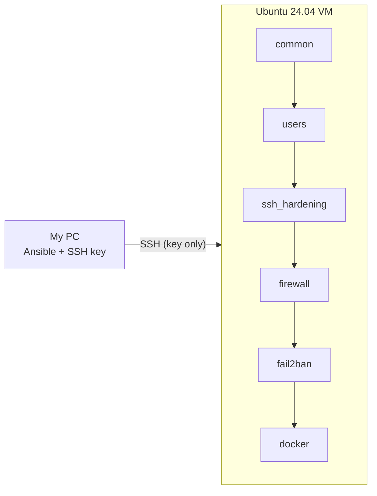
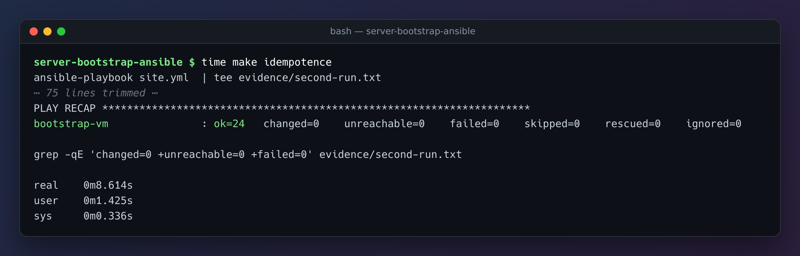
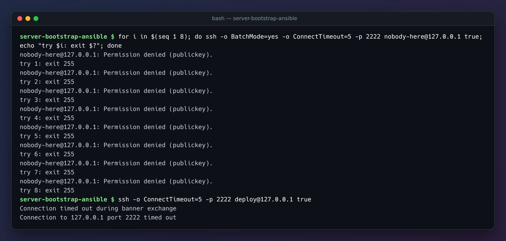

# server-bootstrap-ansible

[](https://github.com/MoYusuf1/server-bootstrap-ansible/actions/workflows/ci.yml)

One Ansible playbook that takes a fresh Ubuntu 24.04 server to a safe, ready-to-work state. Run it once to set the server up. Run it again and nothing changes.

I built it as a learning project. The target is a local virtual machine on my own PC that I can snapshot and reset, not a production server.



## What it does

| Role | What it does | Why |
| --- | --- | --- |
| `common` | Updates packages, installs basic tools, sets the timezone | A new server has old packages with known bugs |
| `users` | Creates an admin user, adds your public key, gives it sudo | You should not work as root or as the installer user |
| `ssh_hardening` | Allows key login only. Blocks passwords and root login | Bots guess SSH passwords all day. A key cannot be guessed |
| `firewall` | UFW: deny all incoming traffic except SSH | Only open what must be reached |
| `fail2ban` | Bans an IP address after 5 failed logins in 10 minutes | Slows down attacks and keeps the logs clean |
| `docker` | Installs Docker Engine and the Compose plugin from Docker's own repo | Ready to run containers |

## Results from my run

Ubuntu 24.04.5, 2 vCPU, 2 GB RAM, KVM. Ansible 14.6.0 (ansible-core 2.21.6). Numbers from `notes.md`.

| Check | Result |
| --- | --- |
| Dry run (`--check`) | 15 would change, 0 failed, 5 ignored |
| First run | 17 changed, 0 failed, 51 s |
| Second run | `changed=0`, 9 s |
| `make verify` | 8 checks, 0 failed |
| Password login and root login | `Permission denied (publickey)` |
| Docker vs UFW drill | UFW allowed only 22, yet a container on 8080 answered HTTP 200. Bound to 127.0.0.1, the same request timed out |
| fail2ban drill | 8 refused logins, then my real user timed out: banned |

| | |
| --- | --- |
|  |  |
|  |  |

All nine screenshots are in [`screenshots/`](screenshots/).

### What broke along the way

The first dry run on a fresh VM failed: `No package matching 'fail2ban' is available`. A new server has an empty package list, and check mode skipped the refresh. Refreshing the list changes no installed software, so that task now runs in check mode too. The fail2ban restart handler also failed in check mode, because fail2ban was not installed yet. It now skips in check mode only.

## Before you start

You need Ansible on your PC and an Ubuntu 24.04 VM you can reach over SSH with a key. [docs/setup.md](docs/setup.md) walks through both, including the snapshot.

## Run it

1. Make your inventory and put in your VM's IP and user name.
   ```bash
   make inventory
   ```
2. Check the values in `group_vars/all.yml`, mainly `users_ssh_public_key_file`.
3. Dry run. Nothing on the server changes. `-K` asks for the VM user's sudo password.
   ```bash
   make dry-run ARGS=-K
   ```
4. Real run.
   ```bash
   make run ARGS=-K
   ```
5. Change `ansible_user` in `inventory/hosts.yml` to `deploy`. That user has key login and sudo without a password, so `-K` is no longer needed.
6. Prove it is idempotent, then check the real result.
   ```bash
   make idempotence
   ```
   ```bash
   make verify
   ```

`make lint` checks the code without a server. CI runs it on every push.

## Key ideas

**Idempotent.** Each task describes a state ("this package is installed"), not an action ("install this package"). Ansible checks first and changes only what is different. The second run must show `changed=0`. `make idempotence` fails if it does not.

**Check mode.** `--check` asks each task "what would you change?" and changes nothing. `--diff` shows the file changes. On a fresh server, some tasks depend on an earlier step that check mode did not really do. Example: the docker service does not exist until Docker is installed. Those tasks show as `ignored` in check mode only. A dry run is a preview, not a promise.

**Lockout guard.** Before SSH stops taking passwords, the playbook logs in from your PC as the new user with the key. If that fails, it stops before it locks you out.

**Ansible "ok" is not proof.** `verify.yml` checks what is really running: the settings `sshd -T` reports, what the server offers to a real SSH client, `ufw status`, the fail2ban jail, and a real `docker run`.

## Decisions

- **Sudo without a password for the admin user.** The user has no password at all, so there is nothing to guess. The SSH key is the only way in. The cost: anyone with that key has root. Keep the private key safe.
- **SSH settings in `/etc/ssh/sshd_config.d/00-hardening.conf`.** sshd keeps the first value it reads, and Ubuntu's own `50-cloud-init.conf` can turn passwords back on. `00-` loads first.
- **Docker's apt repo, not Ubuntu's `docker.io`.** It has the Compose plugin and current releases.
- **No secrets in the repo.** The inventory with your IP is in `.gitignore`. The playbook reads only your public key.

## Watch out: Docker skips UFW

When you publish a port with `docker run -p 8080:80`, Docker writes its own firewall rules ahead of UFW. The port is open even though UFW allows only SSH. The drill above shows it. Fixes: publish on `127.0.0.1:8080:80`, or use the `DOCKER-USER` chain.

## Limits

- Tested on one local Ubuntu 24.04 VM. No other distro.
- CI runs lint and a syntax check only. It does not boot a server.
- The `common` role upgrades packages but does not reboot. Check `/var/run/reboot-required`.

## What I would add next

- Molecule tests that run the roles in CI on every push.
- Automatic security updates with `unattended-upgrades`.
- Fix the Docker and UFW gap in the playbook.
- Run the same playbook on a cloud VM built with Terraform.
- Ansible Vault for the first real secret.

## Files

```
site.yml                 the playbook
verify.yml               checks the real result
group_vars/all.yml       the values you change
inventory/               example inventory (your real one is git-ignored)
roles/<role>/            tasks, defaults, handlers, templates
docs/setup.md            install Ansible, build the VM, take a snapshot
notes.md                 what I saw on my run
```

## License

MIT
