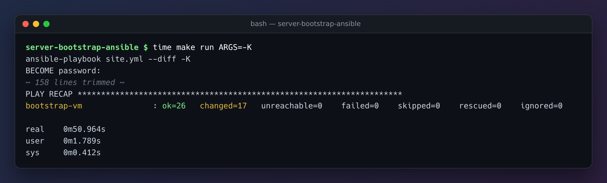
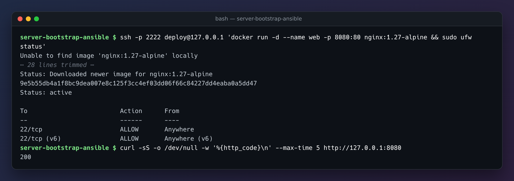
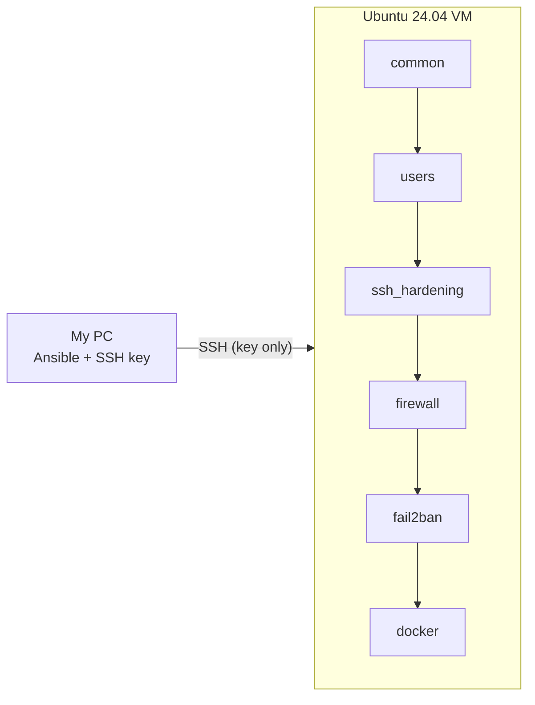

# server-bootstrap-ansible

[](https://github.com/MoYusuf1/server-bootstrap-ansible/actions/workflows/ci.yml)

One Ansible playbook that takes a fresh Ubuntu 24.04 server to a hardened, Docker-ready state: key-only SSH, a firewall, fail2ban, an admin user and Docker, with one known gap described below. It was tested on one local Ubuntu 24.04 VM that I can snapshot and reset.

On that VM the first run made 17 changes and the second run made 0. Testing from outside the server also found a gap: a Docker container answered on a port the firewall was set to block.

## Results from my run

Ubuntu 24.04.5, 2 vCPU, 2 GB RAM, KVM. Ansible 14.6.0 (ansible-core 2.21.6). Raw notes are in `notes.md`.

| Check | Result |
| --- | --- |
| Dry run (`--check`) | 15 would change, 0 failed, 5 ignored (tasks that need an earlier step, see [Check mode](#check-mode)) |
| First run | 17 changed, 0 failed, 51 s |
| Second run | `changed=0`, 9 s |
| `make verify` | 8 checks, 0 failed |
| Password login and root login from my PC | `Permission denied (publickey)` |
| Docker vs UFW drill | UFW allowed only port 22, yet a container published on 8080 answered HTTP 200. Published on 127.0.0.1 instead, the same request timed out |
| fail2ban drill | 8 failed logins were each refused, then my next login as the real user timed out. The VM console showed my PC's IP in the ban list |

| | |
| --- | --- |
|  |  |
|  |  |

The other screenshots are in [`screenshots/`](screenshots/).

### What broke along the way

The first dry run on a fresh VM failed: `No package matching 'fail2ban' is available`. A new server has an empty package list, and check mode skipped the refresh. Refreshing the list changes no installed software, so that task now runs in check mode too. The fail2ban restart handler also failed in check mode, because fail2ban was not installed yet. It now ignores errors only in check mode.

## What it does



| Role | What it does | Why |
| --- | --- | --- |
| `common` | Updates packages, installs basic tools, sets the timezone | A new server has old packages with known bugs |
| `users` | Creates an admin user, adds your public key, gives it sudo | You should not work as root or as the installer user |
| `ssh_hardening` | Allows key login only. Blocks passwords and root login | Bots try SSH passwords all day. A key is much harder to guess |
| `firewall` | UFW: deny incoming traffic except SSH. Docker-published ports still get through, see [Known gap](#known-gap-docker-skips-ufw) | Only open what must be reached |
| `fail2ban` | Bans an IP address after 5 failed logins in 10 minutes | Slows down login attacks |
| `docker` | Installs Docker Engine and the Compose plugin from Docker's own repo | Ready to run containers |

## How it's tested

| Check | Where it runs | What it proves |
| --- | --- | --- |
| `make lint` | CI on every push, and locally | ansible-lint (production profile) and a syntax check pass. No server is needed |
| `make dry-run` | Against the VM | What would change, without changing installed software |
| `make idempotence` | Against the VM | A second run reports `changed=0`. The target fails if it does not |
| `make verify` | Against the VM, plus one SSH check that `make verify` runs from your PC on its own | The real state: the settings `sshd -T` reports, the login methods SSH offers your PC, `ufw status`, the fail2ban jail, and a real `docker run` |

CI does not boot a server. The VM checks are run by hand, and the results above are from my run.

## Run it

You need Ansible on your PC and an Ubuntu 24.04 VM you can reach over SSH with a key. [docs/setup.md](docs/setup.md) walks through both, including the snapshot.

1. Create your inventory, then open `inventory/hosts.yml` and set `ansible_host` to your VM's IP and `ansible_user` to the user you made when you installed Ubuntu. [docs/setup.md](docs/setup.md) step 3 shows how to find the IP.
   ```bash
   make inventory
   ```
2. In `group_vars/all.yml`, set `users_ssh_public_key_file` to your public key, the `.pub` file. The default is `~/.ssh/id_ed25519.pub`.
3. Dry run. `-K` asks for the VM user's sudo password.
   ```bash
   make dry-run ARGS=-K
   ```
4. Take a snapshot first ([docs/setup.md](docs/setup.md) step 5), so you can reset the VM. Then do the real run. It creates an admin user called `deploy` with your key.
   ```bash
   make run ARGS=-K
   ```
5. Check that `ssh deploy@<your-vm-ip>` logs in with your key. Then, in `inventory/hosts.yml`, change `ansible_user` to `deploy`. That user has key login and sudo without a password, so `-K` is no longer needed.
6. Run it a second time to check nothing changes, then check the real result.
   ```bash
   make idempotence
   ```
   ```bash
   make verify
   ```

## How it works

### Describing the end state

Every task except one describes the end state, such as "this package is installed". Ansible checks first and changes only what is different, which is why the second run reports `changed=0`. The one exception is the lockout guard below, a command that never reports a change.

### Check mode

`--check` asks each task what it would change. `--diff` shows the file changes. On a fresh server some tasks depend on an earlier step that check mode does not really perform. For example, the docker service does not exist until Docker is installed. Those tasks would fail in check mode, so the playbook ignores their errors in check mode only and the recap counts them as `ignored`. Treat a dry run as a preview.

### Lockout guard

Before SSH stops taking passwords, the playbook logs in from your PC as the new user with the key. If that fails, it stops before it can lock you out.

### Checking the real result

An `ok` from Ansible means a file or package is in place. It does not show what the running services do, so `verify.yml` checks them directly.

## Decisions

- Sudo without a password for the admin user. The user has no password at all, so there is nothing to guess, and the SSH key is the only way to log in over SSH. The cost is that anyone with that key has root, so keep the private key safe.
- SSH settings live in `/etc/ssh/sshd_config.d/00-hardening.conf`. sshd keeps the first value it reads, and Ubuntu's own `50-cloud-init.conf` can turn passwords back on. `00-` loads first.
- Docker comes from Docker's apt repo instead of Ubuntu's `docker.io`, because it has the Compose plugin and current releases.
- No secrets in the repo. The inventory with your IP is listed in `.gitignore`, and the playbook reads only your public key.

## Known gap: Docker skips UFW

When you publish a port with `docker run -p 8080:80`, Docker adds its own firewall rules, and that traffic never reaches UFW's rules for incoming connections. The port is open even though UFW allows only SSH. The drill above shows it. Until the playbook handles this, publish on `127.0.0.1:8080:80` or add rules to the `DOCKER-USER` chain.

## Limits

- Tested on one local Ubuntu 24.04 VM. No other distro.
- CI runs lint and a syntax check only.
- The `common` role upgrades packages but does not reboot. Check `/var/run/reboot-required`.

## What I would add next

- Close the Docker and UFW gap in the playbook.
- Molecule tests that run the roles in CI on every push.
- Automatic security updates with `unattended-upgrades`.
- Run the same playbook on a cloud VM built with Terraform.
- Ansible Vault for the first real secret.

## Files

```
site.yml                 the playbook
verify.yml               checks the real result
group_vars/all.yml       the values you change
inventory/               example inventory (your real one is git-ignored)
roles/<role>/            tasks, defaults, handlers, templates
docs/setup.md            install Ansible, build the VM, take a snapshot
notes.md                 what I saw on my run
evidence/                output saved by make idempotence
screenshots/             screenshots from my run
```

## License

MIT
